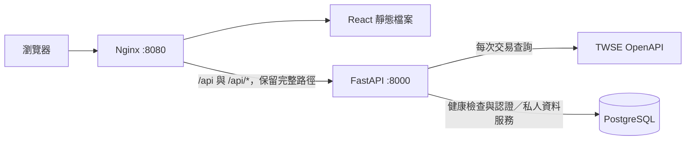

# 台股分析網站後端

使用 Python 3.12、FastAPI 與 uv。

## 本機 Docker 開發環境

前後端儲存庫放在同一層，在後端目錄執行：

```bash
python scripts/init_dev_env.py
docker compose --env-file .env.development -f docker-compose.dev.yml build backend
docker compose --env-file .env.development -f docker-compose.dev.yml build frontend
docker compose --env-file .env.development -f docker-compose.dev.yml up -d --wait
```

開啟 http://localhost:3007。同一套 Compose 管理 Vite、FastAPI、PostgreSQL 三個容器，包含前後端熱更新與自動 migration。開發資料使用獨立的 `.env.development` 與 `tw-stock-dev_dev_postgres_data` 資料卷；既有 Nginx 部署仍使用 `docker-compose.yml`。

已設定適合 8GB 電腦先試用的容器記憶體上限，並依序建置以降低同時負載。實際用量仍取決於其他程式與 Docker Desktop 虛擬機。啟停、資料庫連線、測試帳號、migration 及熱更新排查見 [本機開發指南](docs/local-development.md)。
## GitHub Actions CI

[Backend CI](.github/workflows/ci.yml) 在對 develop／master 的 PR，以及 develop／master／ci/** 分支的 push 時執行。先以 Python 3.12、鎖定的 uv 版本執行 Ruff、mypy、migration 檢查及 PostgreSQL 整合測試；通過後建置標準 Dockerfile，實際啟動映像驗證正式環境設定、migration 與 readiness。

所有測試資料庫皆在 GitHub Runner 建立並於工作結束後丟棄，不連到開發或正式資料庫。CI 的 TWSE 測試使用受控回應；真實來源驗證保留獨立手動執行。部署 Compose 另以一次性 HTTPS 環境驗證登入與 Secure Cookie；通過後，develop／master 的 push 會將同一份映像發布到 GHCR。ci/ghcr-release 只發布候選版本，供合併前驗證。觸發規則、範圍及失敗排查見 [CI 說明](docs/ci.md)。

## GHCR 與正式部署設定

`docker-compose.deploy.yml` 使用前後端各自固定的 GHCR digest，在準備好的主機提供 Nginx HTTPS 入口與獨立正式 PostgreSQL。`scripts/deploy.py` 先驗證映像、來源、資料庫隔離與憑證，再拉取映像、備份資料庫並依序執行 migration 與啟動。

目前尚未建立正式主機；主機、網域與憑證準備好後，依 [部署指南](docs/deployment.md) 設定 `.env.production` 並套用。本機開發繼續使用既有開發 Compose 與資料庫。

## 安裝

在 backend 資料夾執行：

```bash
uv sync --python 3.12
test -f .env || cp .env.example .env
```

依需求填寫 `.env` 設定。

## 啟動

```bash
source .venv/bin/activate
uvicorn app.main:app --reload  
```

若終端機已啟用 `.venv`，直接執行第二行即可。

API：http://localhost:8000

API 文件：http://localhost:8000/api/v1/docs

## TWSE 交易資料 API

每次查詢皆由 FastAPI 直接呼叫 [TWSE OpenAPI](https://openapi.twse.com.tw/)，不寫入或讀取市場資料庫、不提供行情快取或舊資料回退。提供 44 個對應端點，涵蓋價格、成交、指數、外資持股、資券、當沖、鉅額、注意／處置、日曆、權證交易與 ETF 定期定額統計。不含公司基本資料、營收、財報及其他供應商；行情端點維持公開存取。

使用 `app/api/v1/endpoints` → `app/services` 的分層，`v1/router.py` 掛載路由，輸入／輸出 BaseModel 位於 `app/schemas`。前端從 `/api/v1/twse/datasets` 取得功能目錄，再呼叫各 API 專屬端點：

```bash
curl 'http://localhost:8000/api/v1/twse/datasets'
curl 'http://localhost:8000/api/v1/twse/exchangeReport/STOCK_DAY_ALL'
```

每次呼叫取得「來源最新發布資料」，不代表所有資料都在盤中更新。資料欄位、日期與單位保留官方格式，數值以字串傳回。來源失敗回 503，格式錯誤回 502。未知查詢參數回 422，不會假裝支援官方未提供的歷史日期或個股查詢。

完整清單、前端路徑、回應契約及驗證方式見 [TWSE 交易資料](docs/twse-trading-api.md)。2026-10-18 已逐一實測 44 個官方 API，全部成功且欄位與即時 Swagger 相符；[驗證紀錄](docs/twse-live-verification.json) 只保存筆數、欄位與取得時間，不保存行情資料。

## 個股搜尋與詳情

新增 4 個明確宣告的端點：`GET /api/v1/stocks`（q／page／limit）、`GET /api/v1/stocks/{code}`、`GET /api/v1/stocks/{code}/valuation`、`GET /api/v1/stocks/{code}/margin`。每次各自重新取得既有 TWSE 來源全集，在記憶體中搜尋或精確比對代碼，保留精確字串，不儲存或快取行情。連同下方研究工具與 FinMind 歷史研究，目前共有 **59 個公開端點、5 個認證端點，合計 64 個 API 路由**，不計 Swagger 文件頁。

前端 `/stocks` 可搜尋選股，`/stocks/{code}` 依序取得成交、估值與資券，分別標示日期、取得時間及失敗狀態；來源未提供的資券日期不自行補上。完整契約與 154 項整合驗收見 [個股研究 API](docs/stock-research-api.md)。

## 選股、比較、市場總覽與 CSV

新增 `/api/v1/research/screener`、`/screener/export`、`/compare`、`/overview` 四個公開 GET 端點。支援股價／漲跌幅／成交量篩選、精確數值排序與分頁、完整結果 CSV、2～4 檔成交估值比較，以及同一最新交易日的漲跌分布與排行。每次重新取得 TWSE，維持逐次請求、不入庫、不快取，這輪不修改 ORM 或 migration。完整條件、計算、日期與失敗處理見 [公開研究工具](docs/research-tools.md)。

另提供 `/api/v1/research/calendar`、`/calendar/export`、`/risks`：除權息與開休市事項的日期篩選／ICS 下載，以及注意、處置、暫停交易公告彙整。支援個股頁按次取得風險公告、各來源狀態與部分失敗處理，沒有公告不解讀為無風險。完整契約見 [日曆與官方風險公告](docs/calendar-and-risks.md)。

## FinMind 歷史研究

新增 `GET /api/v1/stocks/{code}/analysis`，依序取得日線、月營收及法人資料，提供 MA20／MA60、營收成長率及法人累計。前端從個股摘要進入 `/stocks/:code/history`。後端選用 `FINMIND_API_TOKEN`，不增加 SDK、行情表或快取；日期、單位、部分失敗與只讀驗證指令見 [FinMind 契約](docs/finmind-analysis.md)。真實來源驗證仍待目前執行環境放行網域。

## 帳號與自選股資料表（SQLAlchemy ORM）

已建立 `app.users`、`app.auth_sessions`、`app.verification_tokens` 三張帳號表的 SQLAlchemy 2 ORM 模型及 Alembic migration，支援 Email 唯一性、一對多裝置 Session 與驗證 Token 欄位。後端登入、Cookie 驗證與裝置管理已接上；前端已接上登入／登出與裝置管理；公開註冊及寄信留待後續實作。TWSE 行情維持逐次請求、不入庫、不快取。

另新增 `app.watchlists`、`app.watchlist_items`：每人最多 10 份清單、每份最多 100 檔，清單名稱不分大小寫唯一，股票不重複、排序於 commit 時唯一。已補上服務層的歸屬檢查、即時 TWSE 驗證、並發保護、軟刪除撤銷憑證與一次性 Token 消耗；自選清單 API 與前端尚未串接。

軟刪除帳號會釋出 Email，重新註冊取得新 user_id，不繼承舊資料。清理指令預設刪除失效超過 30 天的 Session／驗證 Token，支援預覽：

```bash
uv run python -m app.services.auth_cleanup --dry-run
uv run python -m app.services.auth_cleanup
```

```bash
uv run alembic upgrade head
uv run alembic check
RUN_DB_TESTS=1 uv run pytest tests/test_database.py tests/test_watchlists.py tests/test_account_services.py -q
```

詳細內容見 [目前 ER 圖](docs/database-er.md)、[帳號資料表](docs/account-tables.md)、[自選清單資料表](docs/watchlist-tables.md) 及 [服務／遷移／清理排程](docs/account-services.md)。

## 後端登入與 Token 驗證

Email／密碼登入採 `pwdlib` Argon2id，必須是已驗證 Email、active 且未刪除的帳號。Session 使用隨機 opaque Token 與 HttpOnly Cookie，資料庫只保存 SHA-256 digest；固定 7 天到期，活動時間更新不延長期限，沒有 JWT 或 Refresh Token。

| 方法／路徑 | 用途 |
| --- | --- |
| `POST /api/v1/auth/login` | 驗證 Email／密碼並設定登入 Cookie |
| `GET /api/v1/me` | 取得目前使用者 |
| `POST /api/v1/auth/logout` | 撤銷目前 Session、清 Cookie，回 204 |
| `GET /api/v1/me/sessions` | 列出自己的有效登入裝置 |
| `POST /api/v1/me/sessions/revoke-others` | 保留目前裝置、撤銷其他 Session，回 204 |

三個 POST 皆要求 `Origin` 精確符合 `AUTH_ALLOWED_ORIGINS`、`X-CSRF-Protection: 1` 與 `Content-Type: application/json`；登出及登出其他裝置不接受 body。採同源 Nginx 入口，未開放跨來源 Cookie CORS。正式環境需明確設定 HTTPS origins，使用 `__Host-session; Secure; HttpOnly; SameSite=Lax; Path=/`，不設 Domain；本機開發使用 `session` Cookie。

本機前端預設使用 Vite `3007`，將相對路徑 `/api/*` 代理至 FastAPI `8000`；瀏覽器仍是同源請求。CSRF 來源預設包含 localhost／127.0.0.1 的 `3007` 與 Nginx `8080`。若既有 `.env` 已覆寫 `AUTH_ALLOWED_ORIGINS`，請同步加入實際的開發入口；這是來源檢查，不會啟用 CORS。

登入限流為每程序每 IP 30 次／60 秒、每 Email 10 次／60 秒，另限制 Argon2 並行數。多 worker／replica 的總限流須由可信入口共用處理；應用程式只採用由可信代理整理後的 client IP。完整回應、錯誤、部署設定、測試與本機測試帳號建立方式見 [認證 API](docs/authentication-api.md)。本輪沿用五張資料表，migration head 仍為 `0004_account_rules`。

## Nginx 整站入口（Docker Compose）

兩個儲存庫放在同一層，前端需使用包含 Nginx Dockerfile 的版本：

```text
workspace/
├── tw-stock-backend/
└── tw-stock-frontend/
```



在後端目錄準備 `.env`，將 `POSTGRES_PASSWORD` 設為自己的密碼，再執行：

```bash
docker compose --env-file .env config --quiet
docker compose --env-file .env up -d --build --wait
```

啟動順序為 PostgreSQL 健康 → 獨立 migrate 程序執行 `alembic upgrade head` → FastAPI ready → Nginx。Migration 失敗會阻止後端及 Nginx 啟動。資料儲存在 `postgres_data` volume；一般停止使用 `docker compose down`，保留資料，不加 `-v`。

開啟 http://localhost:8080 即可使用前端。瀏覽器的 `/api/v1/health/live`、`/api/v1/health/ready` 由同一入口轉送至 FastAPI；`/stocks`、`/watchlists/demo` 等前端路徑可直接開啟或重新整理。不存在的 API 與靜態資產維持 404，不回傳前端 HTML。

只有 Nginx 對主機開放連接埠，預設綁定 `127.0.0.1:8080`。FastAPI 的 8000 與 PostgreSQL 的 5432 不映射至主機；前端不需要另設 CORS。Compose 會將資料庫主機覆寫為 `db`，並忽略本機用的 `DATABASE_URL`，使用這組 Compose 專屬資料庫。

可在 `.env` 調整：

| 變數 | 預設值 | 用途 |
| --- | --- | --- |
| `FRONTEND_CONTEXT` | `../tw-stock-frontend` | 前端儲存庫路徑 |
| `WEB_BIND_ADDRESS` | `127.0.0.1` | Nginx 對主機的綁定位址 |
| `WEB_PORT` | `8080` | 瀏覽器入口連接埠 |
| `APP_ENV` | 範例為 `development` | `production` 時停用 Swagger 與 OpenAPI 文件 |
| `AUTH_ALLOWED_ORIGINS` | 本機 localhost／127.0.0.1 的 Vite 3007 與 Nginx 8080 入口 | JSON 陣列；精確比對瀏覽器 Origin，正式環境僅允許 HTTPS |
| `PASSWORD_MAX_CONCURRENCY` | `2` | 每個後端程序同時執行的 Argon2 工作數 |

目前提供 HTTP 部署入口；公開 HTTPS 部署需另接網域及憑證。Nginx 是此配置的最外層入口，會重設用戶端傳入的轉送標頭；若日後前面再加負載平衡器或 TLS 入口，需配合調整可信代理與協定標頭。FastAPI 僅在內部網路信任 Nginx 傳入的代理資訊。

### 驗證入口

```bash
curl --fail http://localhost:8080/api/v1/health/ready
GATEWAY_BASE_URL=http://127.0.0.1:8080 uv run pytest tests/test_gateway.py -q
docker compose logs web backend migrate
```

整合測試使用實際 Nginx 與 FastAPI，驗證 SPA 子路由、API 前綴、404、靜態資產快取、公開來源及 query string 的代理行為。未設定 `GATEWAY_BASE_URL` 時略過這組測試，一般單元測試不需要啟動 Docker。
