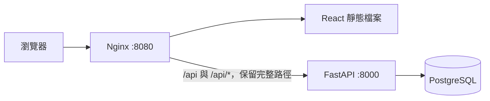

# 台股分析網站後端

使用 Python 3.12、FastAPI 與 uv。

## 安裝

在 backend 資料夾執行：

```bash
uv sync --python 3.12
test -f .env || cp .env.example .env
```

依需求填寫 `.env` 設定。

## 啟動

```bash
source .venv/bin/activate
uvicorn app.main:app --reload
```

若終端機已啟用 `.venv`，直接執行第二行即可。

API：http://localhost:8000

API 文件：http://localhost:8000/api/v1/docs

## 免費官方資料與即時行情

已新增公司主檔、價量、估值、營收、產業財報、法人、資券、集保、內部人及期貨資料集查詢。官方來源先經獨立匯入再供 API 讀取，Fugle 免費 REST 行情另從後端環境變數讀取 key。完整端點、來源範圍、授權差異及匯入方式見 [免費資料 API](docs/free-data-api.md)。

```bash
uv run alembic upgrade head
uv run python -m app.services.open_data_import --dataset twse_revenue
curl 'http://localhost:8000/api/v1/fundamentals/monthly-revenue?dataset=twse_revenue&symbol=2330'
```

## 公開行情 API

使用 `app/api/v1/endpoints` → `services` → PostgreSQL 的分層；`app/api/v1/router.py` 統一掛載 `/api/v1`，輸入與輸出 BaseModel 放在 `app/schemas`。目前提供 TWSE 股票搜尋、批次盤後報價、個股摘要與資料狀態，不含 auth。

```bash
uv run alembic upgrade head
uv run python -m app.services.market_import
curl 'http://localhost:8000/api/v1/instruments?q=2330'
```

官方來源需可連線至 `openapi.twse.com.tw:443`；本次雲端實測被對外代理以 403 阻擋，因此尚未完成真實來源匯入驗證。正式 API 不會自動載入測試假資料。完整分層、端點、資料範圍及測試指令見 [公開行情 API 說明](docs/public-market-api.md)。

## Nginx 整站入口（Docker Compose）

兩個儲存庫放在同一層，前端需使用包含 Nginx Dockerfile 的版本：

```text
workspace/
├── tw-stock-backend/
└── tw-stock-frontend/
```



在後端目錄準備 `.env`，將 `POSTGRES_PASSWORD` 設為自己的密碼，再執行：

```bash
docker compose --env-file .env config --quiet
docker compose --env-file .env up -d --build --wait
```

啟動順序為 PostgreSQL 健康 → 獨立 migrate 程序執行 `alembic upgrade head` → FastAPI ready → Nginx。Migration 失敗會阻止後端及 Nginx 啟動。資料儲存在 `postgres_data` volume；一般停止使用 `docker compose down`，保留資料，不加 `-v`。

開啟 http://localhost:8080 即可使用前端。瀏覽器的 `/api/v1/health/live`、`/api/v1/health/ready` 由同一入口轉送至 FastAPI；`/stocks`、`/watchlists/demo` 等前端路徑可直接開啟或重新整理。不存在的 API 與靜態資產維持 404，不回傳前端 HTML。

只有 Nginx 對主機開放連接埠，預設綁定 `127.0.0.1:8080`。FastAPI 的 8000 與 PostgreSQL 的 5432 不映射至主機；前端不需要另設 CORS。Compose 會將資料庫主機覆寫為 `db`，並忽略本機用的 `DATABASE_URL`，使用這組 Compose 專屬資料庫。

可在 `.env` 調整：

| 變數 | 預設值 | 用途 |
| --- | --- | --- |
| `FRONTEND_CONTEXT` | `../tw-stock-frontend` | 前端儲存庫路徑 |
| `WEB_BIND_ADDRESS` | `127.0.0.1` | Nginx 對主機的綁定位址 |
| `WEB_PORT` | `8080` | 瀏覽器入口連接埠 |
| `APP_ENV` | 範例為 `development` | `production` 時停用 Swagger 與 OpenAPI 文件 |

目前提供 HTTP 部署入口；公開 HTTPS 部署需另接網域及憑證。Nginx 是此配置的最外層入口，會重設用戶端傳入的轉送標頭；若日後前面再加負載平衡器或 TLS 入口，需配合調整可信代理與協定標頭。FastAPI 僅在內部網路信任 Nginx 傳入的代理資訊。

### 驗證入口

```bash
curl --fail http://localhost:8080/api/v1/health/ready
GATEWAY_BASE_URL=http://127.0.0.1:8080 uv run pytest tests/test_gateway.py -q
docker compose logs web backend migrate
```

整合測試使用實際 Nginx 與 FastAPI，驗證 SPA 子路由、API 前綴、404、靜態資產快取、公開來源及 query string 的代理行為。未設定 `GATEWAY_BASE_URL` 時略過這組測試，一般單元測試不需要啟動 Docker。
