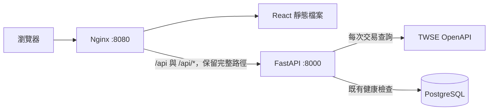

# 台股分析網站後端

使用 Python 3.12、FastAPI 與 uv。

## 安裝

在 backend 資料夾執行：

```bash
uv sync --python 3.12
test -f .env || cp .env.example .env
```

依需求填寫 `.env` 設定。

## 啟動

```bash
source .venv/bin/activate
uvicorn app.main:app --reload
```

若終端機已啟用 `.venv`，直接執行第二行即可。

API：http://localhost:8000

API 文件：http://localhost:8000/api/v1/docs

## TWSE 交易資料 API

每次查詢皆由 FastAPI 直接呼叫 [TWSE OpenAPI](https://openapi.twse.com.tw/)，不寫入或讀取市場資料庫、不提供行情快取或舊資料回退。提供 44 個對應端點，涵蓋價格、成交、指數、外資持股、資券、當沖、鉅額、注意／處置、日曆、權證交易與 ETF 定期定額統計。不含公司基本資料、營收、財報、其他供應商及 auth。

使用 `app/api/v1/endpoints` → `app/services` 的分層，`v1/router.py` 掛載路由，輸入／輸出 BaseModel 位於 `app/schemas`。前端從 `/api/v1/twse/datasets` 取得功能目錄，再呼叫各 API 專屬端點：

```bash
curl 'http://localhost:8000/api/v1/twse/datasets'
curl 'http://localhost:8000/api/v1/twse/exchangeReport/STOCK_DAY_ALL'
```

每次呼叫取得「來源最新發布資料」，不代表所有資料都在盤中更新。資料欄位、日期與單位保留官方格式，數值以字串傳回。來源失敗回 503，格式錯誤回 502。未知查詢參數回 422，不會假裝支援官方未提供的歷史日期或個股查詢。

完整清單、前端路徑、回應契約及驗證方式見 [TWSE 交易資料](docs/twse-trading-api.md)。本環境對 `openapi.twse.com.tw:443` 的請求仍被代理以 403 阻擋；44 個來源已完成端點與離線契約測試，尚未逐一驗收真實回應。

## Nginx 整站入口（Docker Compose）

兩個儲存庫放在同一層，前端需使用包含 Nginx Dockerfile 的版本：

```text
workspace/
├── tw-stock-backend/
└── tw-stock-frontend/
```



在後端目錄準備 `.env`，將 `POSTGRES_PASSWORD` 設為自己的密碼，再執行：

```bash
docker compose --env-file .env config --quiet
docker compose --env-file .env up -d --build --wait
```

啟動順序為 PostgreSQL 健康 → 獨立 migrate 程序執行 `alembic upgrade head` → FastAPI ready → Nginx。Migration 失敗會阻止後端及 Nginx 啟動。資料儲存在 `postgres_data` volume；一般停止使用 `docker compose down`，保留資料，不加 `-v`。

開啟 http://localhost:8080 即可使用前端。瀏覽器的 `/api/v1/health/live`、`/api/v1/health/ready` 由同一入口轉送至 FastAPI；`/stocks`、`/watchlists/demo` 等前端路徑可直接開啟或重新整理。不存在的 API 與靜態資產維持 404，不回傳前端 HTML。

只有 Nginx 對主機開放連接埠，預設綁定 `127.0.0.1:8080`。FastAPI 的 8000 與 PostgreSQL 的 5432 不映射至主機；前端不需要另設 CORS。Compose 會將資料庫主機覆寫為 `db`，並忽略本機用的 `DATABASE_URL`，使用這組 Compose 專屬資料庫。

可在 `.env` 調整：

| 變數 | 預設值 | 用途 |
| --- | --- | --- |
| `FRONTEND_CONTEXT` | `../tw-stock-frontend` | 前端儲存庫路徑 |
| `WEB_BIND_ADDRESS` | `127.0.0.1` | Nginx 對主機的綁定位址 |
| `WEB_PORT` | `8080` | 瀏覽器入口連接埠 |
| `APP_ENV` | 範例為 `development` | `production` 時停用 Swagger 與 OpenAPI 文件 |

目前提供 HTTP 部署入口；公開 HTTPS 部署需另接網域及憑證。Nginx 是此配置的最外層入口，會重設用戶端傳入的轉送標頭；若日後前面再加負載平衡器或 TLS 入口，需配合調整可信代理與協定標頭。FastAPI 僅在內部網路信任 Nginx 傳入的代理資訊。

### 驗證入口

```bash
curl --fail http://localhost:8080/api/v1/health/ready
GATEWAY_BASE_URL=http://127.0.0.1:8080 uv run pytest tests/test_gateway.py -q
docker compose logs web backend migrate
```

整合測試使用實際 Nginx 與 FastAPI，驗證 SPA 子路由、API 前綴、404、靜態資產快取、公開來源及 query string 的代理行為。未設定 `GATEWAY_BASE_URL` 時略過這組測試，一般單元測試不需要啟動 Docker。
