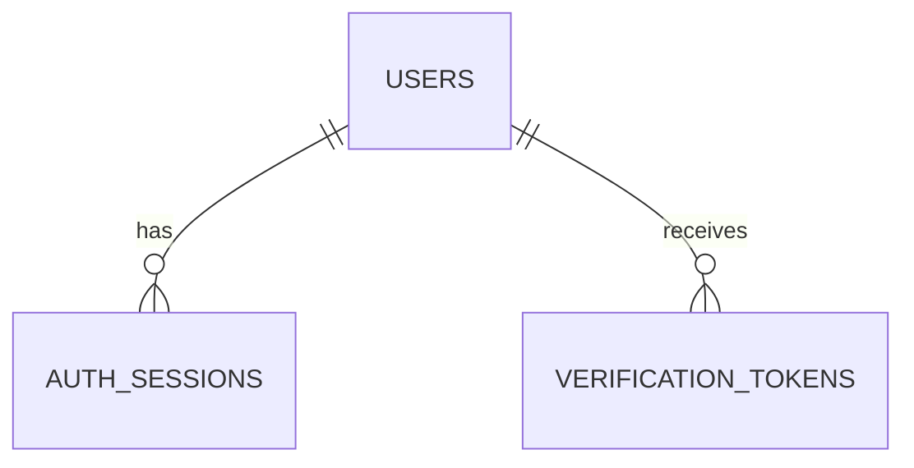

# 帳號資料表

本次實作 Email／密碼帳號的三張資料表、SQLAlchemy 2 ORM 模型與 Alembic migration。
同一帳號允許多裝置登入，預留登出其他裝置、驗證 Email 與忘記密碼所需欄位。
註冊／登入 API、密碼雜湊服務、Cookie／CSRF、寄信、到期清理及帳號恢復流程仍待後續實作。
其他 table 繼續討論後才新增；TWSE 仍逐次請求，不寫行情資料庫、不快取。

## 模型與關聯

| ORM 模型 | PostgreSQL 資料表 | 用途 |
| --- | --- | --- |
| `app.models.User` | `app.users` | 帳號、密碼雜湊與帳號狀態 |
| `app.models.AuthSession` | `app.auth_sessions` | 每次登入各一筆 Session |
| `app.models.VerificationToken` | `app.verification_tokens` | Email 驗證／密碼重設用一次性 Token |



模型集中由 `app/models/__init__.py` 匯出，Alembic 匯入套件後即可取得完整 metadata。
應用程式使用現有 `AsyncSession`；不在 API 啟動或請求中呼叫 `create_all()`。
關聯採 `lazy="raise"`，非同步讀取時以 `selectinload()` 等方式明確載入，避免屬性存取隱含發出 SQL。

## `app.users`

| 欄位 | PostgreSQL 型別 | 規則 |
| --- | --- | --- |
| `id` | UUID | PK，SQLAlchemy insert 時產生 UUID v4 |
| `email` | VARCHAR(254) | NOT NULL、UNIQUE；ORM 指派時 `strip().lower()` |
| `password_hash` | TEXT | NOT NULL、不得空字串；預定儲存完整 Argon2id 編碼結果 |
| `display_name` | VARCHAR(100) | 可 NULL |
| `status` | VARCHAR(32) | NOT NULL；預設 `pending_verification`；僅允許 `pending_verification`、`active`、`disabled` |
| `email_verified_at` | TIMESTAMPTZ | 可 NULL |
| `created_at` | TIMESTAMPTZ | NOT NULL，DB 預設 `now()` |
| `updated_at` | TIMESTAMPTZ | NOT NULL，DB 預設 `now()`；SQLAlchemy 更新時使用 `now()` |
| `deleted_at` | TIMESTAMPTZ | 可 NULL，非 NULL 表示軟刪除 |

- Email 採不分大小寫的帳號規則；不移除 Gmail 的點或 `+alias`。
- DB CHECK 同時要求 Email 非空、已轉小寫且沒有前後一般空白；繞過 ORM 的非標準值會被拒絕。
- Email 格式驗證由未來 API 的輸入 schema 負責，ORM 正規化不等於完整信箱格式驗證。
- Email 唯一性涵蓋軟刪除帳號；不以重複註冊自動覆寫、恢復或重設舊帳號。
- 密碼雜湊本次僅定義儲存欄位；不執行 MD5／SHA-256 密碼雜湊，不另存 salt，也沒有實作密碼設定 hook。
- `updated_at` 沒有 DB trigger；直接使用原生 SQL 更新時，呼叫端必須明確更新時間。

## `app.auth_sessions`

| 欄位 | PostgreSQL 型別 | 規則 |
| --- | --- | --- |
| `id` | UUID | PK，SQLAlchemy insert 時產生 UUID v4 |
| `user_id` | UUID | NOT NULL、FK → `app.users.id`；**不設 UNIQUE** |
| `token_hash` | BYTEA | NOT NULL、UNIQUE；固定 32 bytes 的 SHA-256 digest |
| `created_at` | TIMESTAMPTZ | NOT NULL，DB 預設 `now()` |
| `last_seen_at` | TIMESTAMPTZ | NOT NULL，DB 預設 `now()`；不得早於建立時間 |
| `expires_at` | TIMESTAMPTZ | NOT NULL，必須晚於建立時間 |
| `revoked_at` | TIMESTAMPTZ | 可 NULL；若有值不得早於建立時間 |
| `user_agent` | TEXT | 可 NULL，裝置列表參考資訊 |
| `created_ip` | INET | 可 NULL，支援 IPv4／IPv6 |

- 一次登入建立一筆 Session，支援同帳號多裝置。這張表只接受已關聯使用者的 Session。
- 隨機 Token 的原文預定透過 HttpOnly Cookie 傳遞，DB 僅存 SHA-256 digest；不使用密碼用的 Argon2id 處理隨機 Token。
- `token_hash` 的型別與長度約束無法代替雜湊處理，未來服務層必須產生足夠隨機性的 Token 並雜湊後存入。
- 預留撤銷其他裝置功能：以 `user_id` 查詢並排除目前 Session，再更新 `revoked_at`。
- `user_id` 與 `expires_at` 各有索引，供裝置查詢、撤銷與到期清理使用。
- 有效性須由服務檢查 `revoked_at IS NULL`、`expires_at > now()` 及使用者狀態；存有資料不代表可登入。
- Session 有效期限、續期與活動時間更新頻率尚待登入流程討論，欄位沒有預設固定天數。

## `app.verification_tokens`

| 欄位 | PostgreSQL 型別 | 規則 |
| --- | --- | --- |
| `id` | UUID | PK，SQLAlchemy insert 時產生 UUID v4 |
| `user_id` | UUID | NOT NULL、FK → `app.users.id` |
| `purpose` | VARCHAR(32) | NOT NULL；僅允許 `verify_email`、`reset_password` |
| `token_hash` | BYTEA | NOT NULL、UNIQUE；固定 32 bytes 的 SHA-256 digest |
| `created_at` | TIMESTAMPTZ | NOT NULL，DB 預設 `now()` |
| `expires_at` | TIMESTAMPTZ | NOT NULL，必須晚於建立時間 |
| `consumed_at` | TIMESTAMPTZ | 可 NULL；若有值不得早於建立時間 |
| `created_ip` | INET | 可 NULL，支援 IPv4／IPv6 |

- DB 僅保存雜湊；`consumed_at` 同時表達是否使用及使用時間。
- `(user_id, purpose)` 與 `expires_at` 各有索引，供按用途失效與到期清理使用。
- 一次性使用需要未來服務層以條件 UPDATE／列鎖實作：同時檢查用途、未使用及未到期，再原子消耗 Token。
- 密碼重設服務必須將「消耗 Token、更新密碼雜湊、撤銷所有 Session」放在同一交易。僅有這張表不會自動執行流程或阻止重播。

## 刪除與時間

所有時間欄位均為 TIMESTAMPTZ，應用程式使用帶時區的 UTC datetime，顯示時才轉 Asia/Taipei。
兩張子表的外鍵皆為 `ON DELETE CASCADE`，明確硬刪除帳號時會刪除其私有 Session 與 Token。
一般軟刪除只設定 `deleted_at`，不觸發 cascade；未來停用／刪除帳號服務需明確撤銷 Session。

## 遷移與驗證

在已設定本機 PostgreSQL 連線的環境執行：

```bash
uv run alembic upgrade head
uv run alembic check
RUN_DB_TESTS=1 uv run pytest tests/test_database.py -q
```

`0002_account_tables` 接續 `0001_create_schemas`，只建立三張 `app` 資料表與索引；`market` 保持沒有資料表。
回退會刪除三張帳號表及其資料，只應在可丟棄的測試資料庫驗證：

```bash
uv run alembic downgrade 0001_create_schemas
uv run alembic upgrade head
```

資料庫測試使用真實 PostgreSQL、ORM CRUD／關聯與外鍵，並在每次測試後 rollback，不建立測試帳號種子。
