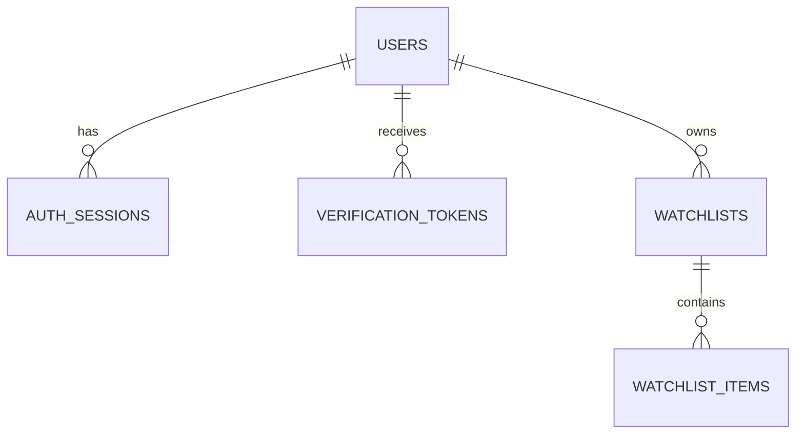

# 帳號資料表

本次實作 Email／密碼帳號的三張資料表、SQLAlchemy 2 ORM 模型與 Alembic migration。
同一帳號允許多裝置登入，預留登出其他裝置、驗證 Email 與忘記密碼所需欄位。
已補上帳號、Session、驗證 Token 服務與到期清理指令，詳見 [帳號與清單服務](account-services.md)。HTTP 認證 API、密碼雜湊／密碼比對、Cookie／CSRF、寄信與帳號恢復流程仍待後續實作。
已接續新增 [自選清單兩表](watchlist-tables.md)，其他 table 繼續討論後才新增；TWSE 仍逐次請求，不寫行情資料庫、不快取。

## 模型與關聯

| ORM 模型 | PostgreSQL 資料表 | 用途 |
| --- | --- | --- |
| `app.models.User` | `app.users` | 帳號、密碼雜湊與帳號狀態 |
| `app.models.AuthSession` | `app.auth_sessions` | 每次登入各一筆 Session |
| `app.models.VerificationToken` | `app.verification_tokens` | Email 驗證／密碼重設用一次性 Token |



模型集中由 `app/models/__init__.py` 匯出，Alembic 匯入套件後即可取得完整 metadata。
應用程式使用現有 `AsyncSession`；不在 API 啟動或請求中呼叫 `create_all()`。
關聯採 `lazy="raise"`，非同步讀取時以 `selectinload()` 等方式明確載入，避免屬性存取隱含發出 SQL。

## `app.users`

| 欄位 | PostgreSQL 型別 | 規則 |
| --- | --- | --- |
| `id` | UUID | PK，SQLAlchemy insert 時產生 UUID v4 |
| `email` | VARCHAR(254) | NOT NULL；ORM 指派時 `strip().lower()`；僅未刪除帳號需唯一 |
| `password_hash` | TEXT | NOT NULL、不得空字串；預定儲存完整 Argon2id 編碼結果 |
| `display_name` | VARCHAR(100) | 可 NULL |
| `status` | VARCHAR(32) | NOT NULL；預設 `pending_verification`；僅允許 `pending_verification`、`active`、`disabled` |
| `email_verified_at` | TIMESTAMPTZ | 可 NULL |
| `created_at` | TIMESTAMPTZ | NOT NULL，DB 預設 `now()` |
| `updated_at` | TIMESTAMPTZ | NOT NULL，DB 預設 `now()`；SQLAlchemy 更新時使用 `now()` |
| `deleted_at` | TIMESTAMPTZ | 可 NULL，非 NULL 表示軟刪除 |

- Email 採不分大小寫的帳號規則；不移除 Gmail 的點或 `+alias`。
- DB CHECK 同時要求 Email 非空、已轉小寫且沒有前後一般空白；繞過 ORM 的非標準值會被拒絕。
- Email 格式驗證由未來 API 的輸入 schema 負責，ORM 正規化不等於完整信箱格式驗證。
- Partial unique index `uq_users_active_email` 為 `lower(email) WHERE deleted_at IS NULL`；停用但未刪除的帳號仍占用 Email。
- 軟刪除後可重新註冊，取得全新 UUID，不繼承舊帳號的清單、Session 或驗證 Token。以 Email 找目前帳號時必須篩選 `deleted_at IS NULL`。
- 密碼雜湊本次僅定義儲存欄位；不執行 MD5／SHA-256 密碼雜湊，不另存 salt，也沒有實作密碼設定 hook。
- `updated_at` 沒有 DB trigger；直接使用原生 SQL 更新時，呼叫端必須明確更新時間。

## `app.auth_sessions`

| 欄位 | PostgreSQL 型別 | 規則 |
| --- | --- | --- |
| `id` | UUID | PK，SQLAlchemy insert 時產生 UUID v4 |
| `user_id` | UUID | NOT NULL、FK → `app.users.id`；**不設 UNIQUE** |
| `token_hash` | BYTEA | NOT NULL、UNIQUE；固定 32 bytes 的 SHA-256 digest |
| `created_at` | TIMESTAMPTZ | NOT NULL，DB 預設 `now()` |
| `last_seen_at` | TIMESTAMPTZ | NOT NULL，DB 預設 `now()`；不得早於建立時間 |
| `expires_at` | TIMESTAMPTZ | NOT NULL，必須晚於建立時間 |
| `revoked_at` | TIMESTAMPTZ | 可 NULL；若有值不得早於建立時間 |
| `user_agent` | TEXT | 可 NULL，裝置列表參考資訊 |
| `created_ip` | INET | 可 NULL，支援 IPv4／IPv6 |

- 一次登入建立一筆 Session，支援同帳號多裝置。這張表只接受已關聯使用者的 Session。
- 隨機 Token 的原文預定透過 HttpOnly Cookie 傳遞，DB 僅存 SHA-256 digest；不使用密碼用的 Argon2id 處理隨機 Token。
- `SessionService` 使用 `secrets.token_urlsafe(32)` 產生憑證，DB 僅存 SHA-256 digest；原文只經回傳值交給呼叫端。
- `revoke_others()` 會驗證目前 Session 所屬帳號及有效性，保留目前裝置並撤銷其他 Session。
- `user_id` 與 `expires_at` 各有索引，供裝置查詢、撤銷與到期清理使用。
- `authenticate()` 檢查未撤銷、未到期、帳號未刪除且狀態為 active；不把 user_id 本身視為登入證明。
- Session 有效期限、續期與活動時間更新頻率尚待登入流程討論，欄位沒有預設固定天數。

## `app.verification_tokens`

| 欄位 | PostgreSQL 型別 | 規則 |
| --- | --- | --- |
| `id` | UUID | PK，SQLAlchemy insert 時產生 UUID v4 |
| `user_id` | UUID | NOT NULL、FK → `app.users.id` |
| `purpose` | VARCHAR(32) | NOT NULL；僅允許 `verify_email`、`reset_password` |
| `token_hash` | BYTEA | NOT NULL、UNIQUE；固定 32 bytes 的 SHA-256 digest |
| `created_at` | TIMESTAMPTZ | NOT NULL，DB 預設 `now()` |
| `expires_at` | TIMESTAMPTZ | NOT NULL，必須晚於建立時間 |
| `consumed_at` | TIMESTAMPTZ | 可 NULL；若有值不得早於建立時間 |
| `revoked_at` | TIMESTAMPTZ | 可 NULL；若有值不得早於建立時間 |
| `created_ip` | INET | 可 NULL，支援 IPv4／IPv6 |

- DB 僅保存雜湊；`consumed_at` 同時表達是否使用及使用時間。
- `(user_id, purpose)` 與 `expires_at` 各有索引，供按用途失效與到期清理使用。
- Partial unique index `(user_id, purpose) WHERE consumed_at IS NULL AND revoked_at IS NULL` 保證同用途最多一張待用 Token。過期列仍會占位，核發服務會先撤銷舊列再建立新列。
- `VerificationService.issue()` 鎖使用者列並撤銷同用途舊 Token，包含已過期但未消耗者；不同用途互不覆蓋。
- 消耗時先鎖使用者，再以用途、未撤銷、未使用及未到期條件 UPDATE，並檢查 RETURNING 結果，防止並發重播。
- `AccountService.reset_password()` 將消耗 Token、更新呼叫端預先算好的密碼雜湊、撤銷所有 Session 與其他待用驗證 Token 放在同一交易。
- 到期判斷使用 `clock_timestamp()`，在取得使用者鎖後重新取時間，不沿用交易等待前的時間。

## 刪除與時間

所有時間欄位均為 TIMESTAMPTZ，應用程式使用帶時區的 UTC datetime，顯示時才轉 Asia/Taipei。
兩張子表的外鍵皆為 `ON DELETE CASCADE`，明確硬刪除帳號時會刪除其私有 Session 與 Token。
新增的自選清單與項目同樣會在硬刪除帳號時 cascade 刪除。
`AccountService.soft_delete()` 在同一交易設定 `deleted_at`、停用帳號、撤銷所有未撤銷 Session 與待用驗證 Token；清單仍保留在舊 user_id 下。直接改 ORM 欄位不會自動執行這些服務規則。

## 遷移與驗證

在已設定本機 PostgreSQL 連線的環境執行：

```bash
uv run alembic upgrade head
uv run alembic check
RUN_DB_TESTS=1 uv run pytest tests/test_database.py -q
```

`0002_account_tables` 建立帳號表、`0003_watchlist_tables` 建立自選清單兩表，`0004_account_rules` 補上本輪已確認的資料約束與憑證撤銷欄位。仍共五張 `app` 表，`market` 沒有資料表。
含資料升降級、重複清單名稱與 Email 重用的處理方式，見 [服務與遷移說明](account-services.md)。
ORM 測試以交易 rollback；服務測試使用實際 commit 與多連線測試鎖定，結束時只清除各測試建立的帳號，不建立固定測試種子。
