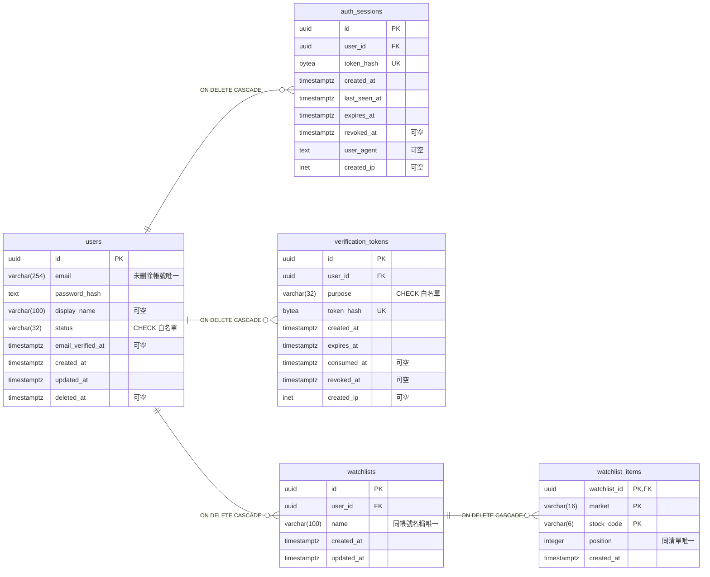

# 目前 ER 圖

五張表都位於 `app` schema，對應 SQLAlchemy ORM 與 Alembic `0004_account_rules`；`market` schema 沒有資料表。

PK＝主鍵，FK＝外鍵，UK＝單欄唯一。圖中未把條件唯一或複合唯一誤標為單欄 UK。

| 表 | DB 約束／索引 |
| --- | --- |
| users | `UNIQUE INDEX lower(email) WHERE deleted_at IS NULL`；email 小寫、trim、非空 CHECK；status 白名單 |
| auth_sessions | token_hash UNIQUE、固定 32 bytes；user_id 與 expires_at 索引；到期／活動／撤銷時間 CHECK |
| verification_tokens | token_hash UNIQUE、固定 32 bytes；purpose 白名單；`UNIQUE (user_id,purpose) WHERE consumed_at IS NULL AND revoked_at IS NULL`；user_id,purpose 與 expires_at 查詢索引 |
| watchlists | `UNIQUE INDEX (user_id,lower(name))`；名稱 trim 非空 CHECK；user_id,created_at 索引 |
| watchlist_items | PK `(watchlist_id,market,stock_code)`；`UNIQUE (watchlist_id,position) DEFERRABLE INITIALLY DEFERRED`；TWSE 白名單、4–6 碼大寫英數、position 非負 CHECK |

status 僅允許 `pending_verification`、`active`、`disabled`；purpose 僅允許 `verify_email`、`reset_password`。
四條外鍵均 `ON DELETE CASCADE`，只作用於硬刪除。軟刪除透過服務撤銷憑證，重新註冊不繼承舊資料。
清單 10 份／股票 100 檔、即時 TWSE 驗證、原子消耗及過期 30 天清理由服務負責，詳見 [服務說明](account-services.md)。
