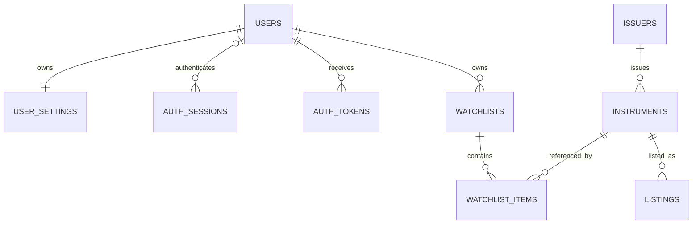

# PostgreSQL 資料模型

目前已實作 `app.users`、`app.auth_sessions`、`app.verification_tokens` 三張帳號表，使用 SQLAlchemy ORM 與 Alembic；欄位、約束與驗證方式以 [帳號資料表](account-tables.md) 為準。

**下方保留早期完整產品構想，尚未逐項確認，不是目前 migration 的規格。** 其中 `auth_tokens` 舊命名、匿名 Session／雙重到期時間、其他使用者表與市場資料表均未實作。本次採 `verification_tokens` 與已登入使用者的一對多 Session；其他 table 待討論。行情維持逐次向 TWSE 請求、不入庫、不快取，`market` schema 目前沒有資料表。

資料庫連線設定保存在 backend/.env；啟動與遷移步驟見 [README](../README.md)。

審查補充（下列表格未逐項展開的欄位也須實作）：

- market.ingestion_leases 以 dataset+scope_key 作穩定 PK，含 owner_run_id、fencing_epoch、lease_until；dataset_heads 保存 last_fencing_epoch，發布時於同交易驗證目前租約。
- daily_prices 增加 official_change、official_reference_price、change_basis；上游未提供者保留 NULL，不自行假造官方欄位。
- monthly_revenues、financial_reports、valuation_snapshots、corporate_actions、listings 都保留 ingestion_run_id 及 raw_object_id；透過批次取得 retrieved_at 與 data_version，來源修訂可追溯。
- 查單一 instrument 的歷史圖表時，依 listings 有效期間選擇當日唯一 venue，並使用明訂 price_scope；轉板前後合併為同一時間序列，同日多來源不能簡單 UNION 產生重複 K 棒。無法唯一判定則隔離該日並回品質警告。

狀態：概念與邏輯設計，尚未建立資料表。app 儲存使用者資料；market 儲存為分析功能必要且已確認可保存的市場資料。不同 schema 共用一個 PostgreSQL，逐階段建立。

## 1. 使用者資料

| 表 | 主要欄位 | 約束與規則 |
| --- | --- | --- |
| app.users | id UUID、email、email_normalized、password_hash、display_name、status、email_verified_at、created_at、updated_at | normalized email UNIQUE NOT NULL；status 白名單；hash 不出現在 DTO |
| app.user_settings | user_id、theme、locale、timezone、default_chart_range、indicator_preferences JSONB、version、updated_at | user_id PK/FK；theme/range 白名單；JSONB 經 Pydantic 驗證並限制大小；version 正整數 |
| app.auth_sessions | id UUID、token_hash、user_id nullable、state、csrf_secret、created_at、last_seen_at、idle_expires_at、absolute_expires_at、revoked_at | token_hash UNIQUE；anonymous 無 user，authenticated 有 user；到期順序 CHECK |
| app.auth_tokens | id、user_id、purpose、token_hash、expires_at、consumed_at、created_at | hash UNIQUE；purpose 驗證信箱／密碼重設；一次性消耗 |
| app.watchlists | id UUID、user_id、name、name_normalized、version、created_at、updated_at | UNIQUE(user_id,name_normalized)；名稱 1–64 字；version 正整數 |
| app.watchlist_items | watchlist_id、instrument_id、position、created_at | PK(watchlist_id,instrument_id)；position>=0；market instrument FK |
| app.notification_outbox | id、user_id、purpose、encrypted_payload、status、attempt_count、next_attempt_at、expires_at、sent_at | 用戶／token 與 outbox 同交易；敏感內容加密且短期保存；重試有上限 |
| app.rate_limit_windows | key_hash、action、window_start、count、expires_at | 複合 PK；不保存原始 email；以原子增量計數；到期清理 |

name_normalized 先採 trim + Unicode 正規化 + 大小寫一致的產品規則，保留原顯示值。position 不在初期設每清單唯一，以免單交易重排時產生暫時衝突；排序請求需鎖清單並一次重寫，讀取以 position、instrument_id 作穩定排序。

使用者的私人關聯可在正式刪除流程中 cascade；商品下市不刪主檔或使用者清單項目。初期不開放任意管理員變更資料的公開端點。

## 2. 市場資料

| 表 | 關鍵內容 | 範圍與唯一性 |
| --- | --- | --- |
| market.issuers | 公司 ID、官方公司識別、名稱、產業分類及來源 | 財報／營收屬發行公司，不只屬某個交易代碼 |
| market.instruments | 穩定 UUID、issuer_id、instrument_type、currency、ISIN（若有）、status | ticker 不作 PK，不轉數字；只把已分類普通股納入第一版 |
| market.listings | instrument_id、market、ticker、valid_from、valid_to、source_id | 保留轉板／改碼；現行 market+ticker 部分唯一索引；歷史區間不重疊由匯入驗證 |
| market.trading_calendar | market、trade_date、is_open、reason、source_id | PK(market,trade_date)；可追蹤臨時休市修訂 |
| market.daily_prices | instrument_id、venue、trade_date、price_scope、OHLC、volume_shares、turnover、trade_count、status、ingestion_run_id、data_version | PK(instrument_id,venue,trade_date,price_scope)；存目前有效未還原日資料，修訂可由原始版本追溯 |
| market.monthly_revenues | issuer_id、year_month、statement_scope、revenue、currency、published_at、first_seen_at、available_at、revision、source_id | 公司＋月份＋口徑＋revision 唯一；月份是資料期間，不是發布日 |
| market.financial_reports | id、issuer_id、period_start/end、scope、report_type、industry_template、published_at、first_seen_at、available_at、revision、source_id | 保存每個版本；報表身份包含期間、口徑、類型與版本 |
| market.financial_facts | report_id、metric_code、period_basis、value、currency、source_unit、normalized_unit、status | PK(report_id,metric_code,period_basis)；金額、比率、EPS 分類 |
| market.valuation_snapshots | instrument_id、trade_date、pe、pb、dividend_yield、method、source_id、revision | 官方值和自算值不同 method；不可相互覆蓋 |
| market.corporate_actions | instrument_id、action_type、effective_date、announced_at、parameters、status、source_id、revision | 有資料才提供事件標記；復權功能另待完整涵蓋驗證 |
| market.ingestion_runs | id、dataset、source、scope_key、attempt、status、lease_until、lease_version、started_at、completed_at、parser_version、checksum、row_count、error_summary | 工作範圍與 attempt 唯一；完成批次不可被失敗重跑抹去 |
| market.raw_objects | id、run_id、storage_key、checksum、retrieved_at、source_url、license_ref、expires_at | 保存原始取得證據；實際內容放受控儲存，適用保留政策 |
| market.dataset_heads | dataset、scope_key、published_version、run_id、published_at | 小型發布指標；與正規化資料在同交易更新 |

不是每張表在 P1 就建立。P2 先做主檔、日曆、日資料與匯入；P4 才做財報／營收。指標第一版以有界計算與資料版本快取為主，不預先為每種參數建立海量 indicator_values。

市場發布採短交易：完成 staging 驗證 → upsert 當前資料／追加財報版本 → 更新 dataset_heads → commit。失敗 rollback，讀取仍看到舊版。原始資料檔及校驗值可追蹤被修訂的價格；第一版不提供歷史時點回測 API，不能把目前價格快照當完整 point-in-time 資料庫。

## 3. 型別與缺值

- ID 用 UUID；股票代碼、ISIN、公司識別用文字。
- trade_date、year_month 對應的月份首日、period_end 用 DATE；真正時間點用 timestamptz，應用程式統一 UTC，顯示時轉 Asia/Taipei。timestamptz 不保存原始時區名稱，來源時區另記。[PostgreSQL 日期時間](https://www.postgresql.org/docs/current/datatype-datetime.html)。
- 價格建議 NUMERIC(20,6)，財務金額 NUMERIC(30,6)，比率／EPS 依原始精度規劃；部署前用代表性資料驗證範圍。volume/trade_count 用 BIGINT。
- 財務數值使用 Decimal；API 精確小數與可能超過 JS 安全整數的值輸出字串。技術指標可使用受控 float64 計算並以固定容差測試；不拿圖表浮點值當財務原值。[PostgreSQL numeric](https://www.postgresql.org/docs/current/datatype-numeric.html)。
- 可缺資料欄位使用 NULL 搭配狀態，不設無意義 default 0。原始空字串、--、NA 保留在原始證據並分類成 missing/not_applicable 等。
- OHLC 非空時檢查 low<=open/close<=high；成交量非負。無成交資料允許 OHLC 空值並有狀態。EPS、淨利可負，不能加整表非負約束。

## 4. 索引與查詢

| 查詢 | 初期索引 |
| --- | --- |
| 登入／email 唯一 | users(email_normalized) UNIQUE |
| Cookie 查 session | auth_sessions(token_hash) UNIQUE |
| 撤銷使用者 sessions | auth_sessions(user_id)，必要時有效列部分索引 |
| 到期清理 | sessions/tokens/rate_limit_windows 的到期時間索引 |
| 我的清單 | watchlists(user_id,created_at) |
| 清單項目 | PK 支援 watchlist_id；另依 position 讀取，100 檔內先量測 |
| 現行股票代碼 | listings(market,ticker) 現行部分唯一索引 |
| 日 K 區間 | daily_prices(instrument_id,trade_date)；過濾 venue/scope |
| 財報／營收序列 | issuer_id + period/year_month + revision |
| 待處理郵件 | status + next_attempt_at 的部分索引 |

名稱搜尋初期股票宇宙較小，可先使用有上限的查詢；效能量測後再加 pg_trgm，不一開始部署搜尋叢集。外鍵引用端不會自動產生所有需要的索引，應按查詢補足。[PostgreSQL constraints](https://www.postgresql.org/docs/current/ddl-constraints.html)。

## 5. 交易案例

新增清單：鎖 users 父列 → 檢查數量 → insert → UNIQUE 處理名稱衝突 → commit。

新增股票：查 owner 並鎖 watchlist → 已存在則直接回現狀 → 檢查容量 → insert → version+1 → commit。

排序：鎖 watchlist 並驗 version → 確認完整 ID 集合 → 更新 positions → version+1 → commit。舊 version 回 409。

重設密碼：原子消耗有效 token → 確認新 hash 可用 → 更新密碼與撤銷 sessions → commit；昂貴 hash 計算在交易前完成。

市場批次讀取：圖表請求讀價格與其版本使用同一快照／單一查詢，或短 REPEATABLE READ 讀交易，計算前先取出 DTO 並結束交易，確保同一圖表不混入跨發布版本。

## 6. 保留與權限

使用者資料依備份政策保存。過期 session/token、限流資料與成功寄信 payload 定期清理；不得將 token 或私人資料塞進長期一般日誌。原始市場資料保留範圍依各資料來源使用條件及儲存成本決定，證據 metadata 與 checksum 可長期保存。

應用角色只有必要 schema 權限，migration 角色負責 DDL；同步角色可寫 market，不需讀 password_hash。所有設計經 Alembic migration 實作並用 PostgreSQL 整合測試驗證。
