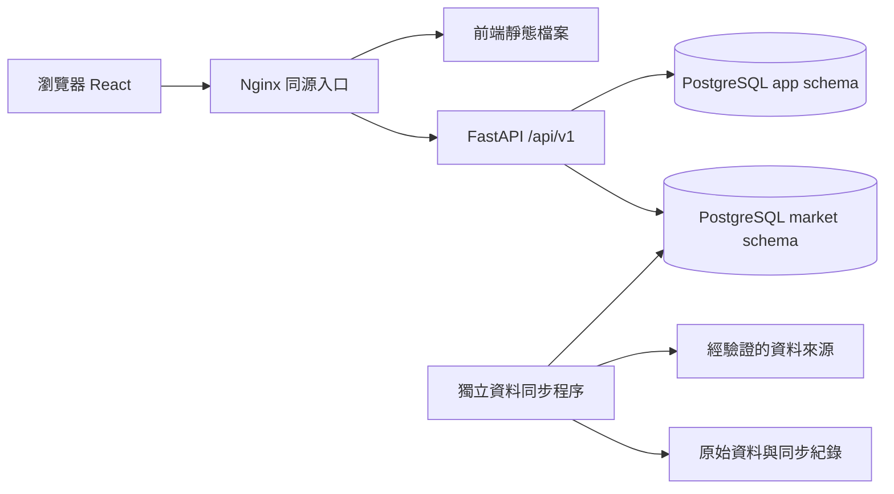

# 台股分析網站：完整實作規劃 v1

規劃日期：2026-10-16。此文件為目標系統設計；目前已建立開發骨架、health API 與啟動設定，已加入第一批 TWSE 公開查詢端點，真實來源的雲端連通驗證仍受網路設定限制。前後端分別保存在 tw-stock-frontend／tw-stock-backend 儲存庫，兩者各自讀自己的 .env；開發時後端以 uvicorn app.main:app --reload、前端以 npm run dev 啟動。另提供由 Nginx 統一入口的 Compose 部署流程，見 [後端 README](../README.md)。

## 1. 第一版產品

讓使用者完成「搜尋台股 → 閱讀基本面與技術圖 → 加入自選股 → 下次登入繼續追蹤」。預設繁體中文、台幣、Asia/Taipei、桌面與手機可用。

| 第一版納入 | 後續擴充 |
| --- | --- |
| 上市、上櫃普通股；收盤後日資料 | ETF、興櫃、權證、期貨 |
| 股票搜尋、個股摘要、資料日期與來源 | 全市場條件選股、多股比較 |
| 日 K、成交量、MA、RSI、MACD、布林通道 | 即時報價、分 K、週／月 K |
| 月營收、來源可支持的 EPS／估值／財報摘要 | 深度產業分析、完整財務模型 |
| 註冊登入、信箱驗證、重設密碼、自選股、偏好 | 社群登入、訂閱、推播 |
| 數值趨勢及計算說明 | 歷史回測、下單、投組績效 |

公開資料訪客可讀，儲存個人資料才需要登入。先驗證一組代表性標的再擴大覆蓋；金融業使用適用欄位，未支持市場、欄位或歷史範圍明確標示。

## 2. 技術選擇

使用者已指定 React、Python、PostgreSQL、SQLAlchemy AsyncSession、asyncpg。其餘是本規劃的預設選擇。

| 項目 | 選擇與用途 |
| --- | --- |
| 前端 | React + TypeScript + Vite，互動式 SPA |
| 路由 | React Router Data mode，URL 與頁面錯誤邊界 |
| API 資料狀態 | TanStack Query，查詢快取與更新 |
| 樣式與表單 | CSS Modules + CSS variables；React Hook Form + Zod |
| 圖表 | Lightweight Charts，金融時間序列；保留其署名要求 |
| 後端 | FastAPI + Pydantic，驗證與 OpenAPI 契約 |
| 資料庫 | PostgreSQL + SQLAlchemy 2.x async + asyncpg |
| 遷移 | Alembic，每次結構變更可追蹤 |
| 來源介接 | httpx + 各來源獨立 adapter |
| 依賴管理 | npm + package-lock；uv + uv.lock |
| 測試 | Vitest、Testing Library、pytest、Playwright |

實作時選相容穩定版本並鎖定。先不引入 Redux、Redis、Celery、Kubernetes 或微服務；需要的抽象以來源介接、認證與資料契約為主。[React 官方說明 Vite 類型的獨立前端需要自行補足路由與資料載入方案](https://react.dev/learn/build-a-react-app-from-scratch)。

## 3. 系統結構

前後端各自使用 Git 儲存庫及建置流程。Compose 由 Nginx 提供建置後的 React 靜態檔案，並將 /api/v1 轉送到內部 FastAPI；API 與 PostgreSQL 不對主機開放連接埠。目前入口為 HTTP，公開 HTTPS 部署需配合網域及憑證。本機開發仍可由 Vite proxy 轉送 /api。

PostgreSQL 主要儲存帳號、自選股與偏好。為支援歷史圖表、重複讀取及上游故障時的可用性，另設 market schema 儲存必要主檔、日資料及財報快照，初期仍共用一個 PostgreSQL。歷史目標為日資料兩年、月營收三年、財報十二季；這是產品目標，必須先通過來源覆蓋與使用條件驗證。

資料同步由獨立工作執行，API 讀已發布資料；開啟一個股票頁不臨時抓數個外部網站。API 與同步程序共用後端專案，但分開啟動。

## 4. 功能責任

| 功能 | 前端 | 後端 |
| --- | --- | --- |
| 股票搜尋 | 防抖、鍵盤選取、分頁 | 主檔查詢、商品分類、排序 |
| 個股摘要 | 價格、資料日與來源狀態 | 最新有效資料、參考價與變動語意 |
| 技術分析 | 繪圖、縮放、指標開關 | OHLCV、指標計算與版本 |
| 基本面 | 時間序列、表格、欄位解釋 | 期間對齊、單位、財報口徑 |
| 自選股 | 操作、待處理與錯誤呈現 | 授權、唯一性、交易與持久儲存 |
| 認證 | 表單、導向、清除私人快取 | session、密碼、CSRF、撤銷 |

## 5. 資料正確性的底線

1. 價格與財務值的標準算法只在後端；前端不另算一套 RSI／ROE。
2. 交易日、資料取得時間、財報公告時間各自保存。
3. 零、未公告、不適用、抓取失敗與資料不足是不同狀態。
4. 第一版使用未還原價格，清楚標示；事件資料完整前不提供復權或回測。
5. 私人資料的 owner 從 session 取得，不採信前端 user_id。
6. 每個請求／獨立工作有自己的 AsyncSession，服務層管理交易。
7. 私人回應不進共享快取，登出與帳號切換清除前端私人資料。

## 6. 文件導覽

1. [前端頁面與實作規格](../../frontend/docs/frontend-plan.md)
2. [後端、交易與登入設計](backend-plan.md)
3. [資料表、約束與索引](database-plan.md)
4. [API 契約](api-contract.md)
5. [市場資料、公式與品質](market-data-plan.md)
6. [交付順序、測試與部署](implementation-roadmap.md)

各文件中的時間、數量限制與效能數字是可調整的工程預設，不是已測得結果或第三方承諾。最初的資料夾骨架先保留；規劃新增的檔案、模組與資料表等到各階段實作才建立。
