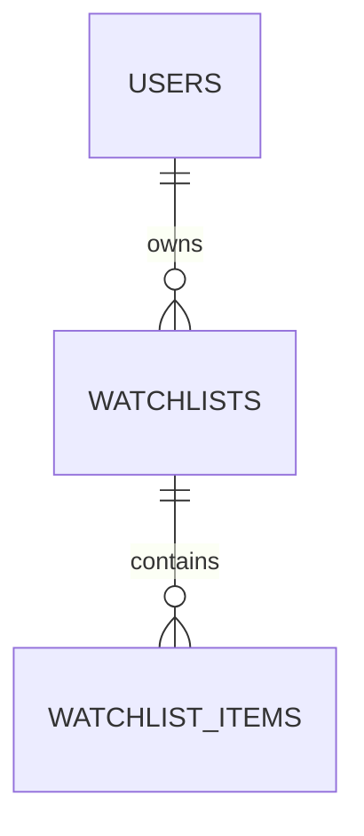

# 自選清單資料表

本次新增 `app.watchlists`、`app.watchlist_items` 的 SQLAlchemy 2 ORM 模型、關聯與 Alembic migration，延續既有三張帳號表。
一個使用者可以建立多份清單，每份清單儲存市場、股票代碼與順序，不保存價格、成交量、估值或行情快取。
已完成 ORM 與 `WatchlistService` 的歸屬檢查、即時驗證、容量與排序交易；HTTP API、登入身分取得與前端串接待後續實作。

## 模型與關聯



- `app.models.User.watchlists` → `app.models.Watchlist`，每人可有多份清單。
- `Watchlist.items` → `app.models.WatchlistItem`，每份清單可有多筆股票。
- 兩段外鍵均為 `ON DELETE CASCADE`；ORM 同時支援 `delete-orphan`。
- 關聯維持 `lazy="raise"`，以 `selectinload()` 等方式明確載入，避免非同步隱含查詢。
- `Watchlist.items` 預設依 `(position, market, stock_code)` 排序；`0004` 起同清單的 position 必須唯一。

## `app.watchlists`

| 欄位 | PostgreSQL 型別 | 規則 |
| --- | --- | --- |
| `id` | UUID | PK，SQLAlchemy insert 時產生 UUID v4 |
| `user_id` | UUID | NOT NULL、FK → `app.users.id`，不設 UNIQUE |
| `name` | VARCHAR(100) | NOT NULL；ORM 指派時去除前後空白；DB CHECK 非空且沒有前後一般空白 |
| `created_at` | TIMESTAMPTZ | NOT NULL，DB 預設 `now()` |
| `updated_at` | TIMESTAMPTZ | NOT NULL，DB 預設 `now()`；SQLAlchemy 更新本列時使用 `now()` |

索引 `(user_id, created_at)` 支援查詢帳號所屬清單；`UNIQUE INDEX (user_id, lower(name))` 使同帳號的名稱去除前後空白後、不分大小寫唯一，不同帳號可同名。
每人最多 10 份清單，由服務在鎖定使用者列的交易中檢查並新增；不預設建立清單。
`WatchlistService` 新增、移除或重排項目時會在同一交易更新父清單 `updated_at`；單純直接操作子項目 ORM 不會自動更新父列。
直接以原生 SQL 更新清單時，同樣需明確更新 `updated_at`，目前沒有 DB trigger。

## `app.watchlist_items`

| 欄位 | PostgreSQL 型別 | 規則 |
| --- | --- | --- |
| `watchlist_id` | UUID | NOT NULL、FK → `app.watchlists.id`，複合 PK 的第一欄 |
| `market` | VARCHAR(16) | NOT NULL，複合 PK；預設且目前僅允許 `TWSE` |
| `stock_code` | VARCHAR(6) | NOT NULL，複合 PK；4–6 碼大寫英數，與既有個股 API 一致 |
| `position` | INTEGER | NOT NULL、無預設值，CHECK `position >= 0`；同清單唯一 |
| `created_at` | TIMESTAMPTZ | NOT NULL，DB 預設 `now()` |

複合 PK 為 `(watchlist_id, market, stock_code)`，同清單不會重複加入同市場、同股票；同一股票可以出現在其他清單或其他帳號。
`market`／`stock_code` 在 ORM 指派時去除前後空白並轉大寫。代碼保持字串，保留 `0050`、`00632R` 等前導零與字母。
`UNIQUE (watchlist_id, position) DEFERRABLE INITIALLY DEFERRED` 同時支援排序查詢與交易內交換順序，commit 時必須沒有重複位置。
服務新增時附加在末尾；移除或重排後使用 0 起算連續位置，每份清單最多 100 檔。新增／移除／排序均先鎖使用者再鎖清單，檢查與寫入在同一交易，避免並發超額。

沒有證券主檔外鍵。服務新增股票前先檢查帳號與清單歸屬，結束 DB 交易後呼叫既有 `StockService.quote()` 即時查 TWSE `STOCK_DAY_ALL`；不存在回 404，來源失敗回 503，格式錯誤回 502，不新增項目或沿用舊驗證結果。
來源查詢後在寫入交易再次驗證帳號、歸屬、重複項目與容量；HTTP 期間不持有資料庫連線或鎖。即使請求時曾存在清單，回應期間帳號／清單被刪除仍會拒絕寫入。
目前僅支援既有 TWSE 市場；若日後新增其他市場，需先確認來源與契約，再以 migration 擴充白名單。
股票下市、改碼或代碼重新使用時，不會自動移除或轉移自選項目；市場與代碼不代表永久的證券身分。
顯示行情時仍須每次請求向 TWSE 取得，來源查不到時保留使用者的自選項目並由未來 API／前端表達缺值。

## 歸屬、交易與刪除

- 服務的 user_id 必須由未來認證入口提供，不能直接相信 HTTP body。服務會確認帳號 active／未刪除，以 user_id 與清單 ID 共同篩選；其他帳號的清單回 404。
- 已有跨帳號服務測試；沒有新增 HTTP 端點或 PostgreSQL RLS，HTTP 身分驗證、Cookie／CSRF 仍待串接。
- 重排請求必須包含全部且僅有的現有股票，不得重複；缺少或多出項目會整筆失敗，不進行部分排序。
- 刪除清單會刪除其項目；硬刪除使用者會依序刪除其清單與項目。其他帳號資料不受影響。
- 帳號軟刪除不會 cascade；可否讀寫仍須由服務檢查帳號狀態。

## 遷移與驗證

```bash
uv run alembic upgrade head
uv run alembic check
RUN_DB_TESTS=1 uv run pytest tests/test_database.py tests/test_watchlists.py tests/test_account_services.py -q
```

`0004_account_rules` 會按原本 `(position, market, stock_code)` 的穩定順序重新編號既有項目，再加入延後檢查唯一約束；同帳號若已有不分大小寫的同名清單，升級會中止，需先人工處理名稱。
詳細服務介面、清理指令、資料遷移與並發驗證見 [帳號與清單服務](account-services.md)，完整圖見 [目前 ER 圖](database-er.md)。
