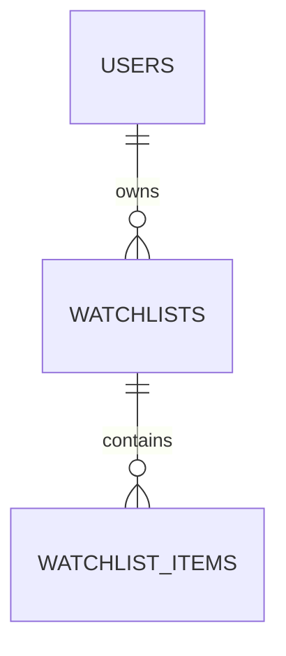

# 自選清單資料表

本次新增 `app.watchlists`、`app.watchlist_items` 的 SQLAlchemy 2 ORM 模型、關聯與 Alembic migration，延續既有三張帳號表。
一個使用者可以建立多份清單，每份清單儲存市場、股票代碼與順序，不保存價格、成交量、估值或行情快取。
目前完成資料層，自選股 API、登入授權與前端串接待後續實作。

## 模型與關聯



- `app.models.User.watchlists` → `app.models.Watchlist`，每人可有多份清單。
- `Watchlist.items` → `app.models.WatchlistItem`，每份清單可有多筆股票。
- 兩段外鍵均為 `ON DELETE CASCADE`；ORM 同時支援 `delete-orphan`。
- 關聯維持 `lazy="raise"`，以 `selectinload()` 等方式明確載入，避免非同步隱含查詢。
- `Watchlist.items` 預設依 `(position, market, stock_code)` 排序；相同 position 仍有穩定順序。

## `app.watchlists`

| 欄位 | PostgreSQL 型別 | 規則 |
| --- | --- | --- |
| `id` | UUID | PK，SQLAlchemy insert 時產生 UUID v4 |
| `user_id` | UUID | NOT NULL、FK → `app.users.id`，不設 UNIQUE |
| `name` | VARCHAR(100) | NOT NULL；ORM 指派時去除前後空白；DB CHECK 非空且沒有前後一般空白 |
| `created_at` | TIMESTAMPTZ | NOT NULL，DB 預設 `now()` |
| `updated_at` | TIMESTAMPTZ | NOT NULL，DB 預設 `now()`；SQLAlchemy 更新本列時使用 `now()` |

索引 `(user_id, created_at)` 支援查詢帳號所屬清單；清單以 UUID 區分，本版不要求清單名稱唯一，也不預設建立任何清單。
新增、移除或重排子項目時，不會自動觸發父清單的 `updated_at`；未來服務層需在同一交易明確更新父列。
直接以原生 SQL 更新清單時，同樣需明確更新 `updated_at`，目前沒有 DB trigger。

## `app.watchlist_items`

| 欄位 | PostgreSQL 型別 | 規則 |
| --- | --- | --- |
| `watchlist_id` | UUID | NOT NULL、FK → `app.watchlists.id`，複合 PK 的第一欄 |
| `market` | VARCHAR(16) | NOT NULL，複合 PK；預設且目前僅允許 `TWSE` |
| `stock_code` | VARCHAR(6) | NOT NULL，複合 PK；4–6 碼大寫英數，與既有個股 API 一致 |
| `position` | INTEGER | NOT NULL，預設 0，CHECK `position >= 0` |
| `created_at` | TIMESTAMPTZ | NOT NULL，DB 預設 `now()` |

複合 PK 為 `(watchlist_id, market, stock_code)`，同清單不會重複加入同市場、同股票；同一股票可以出現在其他清單或其他帳號。
`market`／`stock_code` 在 ORM 指派時去除前後空白並轉大寫。代碼保持字串，保留 `0050`、`00632R` 等前導零與字母。
索引 `(watchlist_id, position)` 支援按清單排序查詢。position 可重複、不要求連號，避免同一交易交換順序時產生唯一約束衝突。

沒有證券主檔外鍵，僅檢查代碼格式，不代表該股票目前仍在官方資料中。
目前僅支援既有 TWSE 市場；若日後新增其他市場，需先確認來源與契約，再以 migration 擴充白名單。
股票下市、改碼或代碼重新使用時，不會自動移除或轉移自選項目；市場與代碼不代表永久的證券身分。
顯示行情時仍須每次請求向 TWSE 取得，來源查不到時保留使用者的自選項目並由未來 API／前端表達缺值。

## 歸屬、交易與刪除

- `user_id` 建立資料歸屬，不會自動執行登入授權。未來每個讀寫服務必須以已驗證的使用者 ID 篩選清單；項目操作須先確認其清單 owner，不能只相信前端傳入的 ID。
- 外鍵不限制誰能發出 ORM 查詢，也沒有新增公開自選股端點或 PostgreSQL RLS。跨帳號 HTTP 存取測試需在授權服務實作時補上。
- 重排多筆項目與更新清單時間應在同一交易完成；並發寫入與清單容量政策待 API 設計時討論，本次不增加未確認的容量上限。
- 刪除清單會刪除其項目；硬刪除使用者會依序刪除其清單與項目。其他帳號資料不受影響。
- 帳號軟刪除不會 cascade；可否讀寫仍須由服務檢查帳號狀態。

## 遷移與驗證

```bash
uv run alembic upgrade head
uv run alembic check
RUN_DB_TESTS=1 uv run pytest tests/test_database.py tests/test_watchlists.py -q
```

`0003_watchlist_tables` 接續 `0002_account_tables`，只新增兩張 `app` 表與索引；加上原有帳號表共五張，`market` schema 保持沒有資料表。
在可丟棄的測試資料庫，可回退至 `0002_account_tables`；這會刪除自選清單及項目，保留原有帳號三表。
測試涵蓋多清單／多帳號、字串代碼、去重、排序、外鍵、CHECK、ORM 關聯與 cascade，結束時 rollback 測試資料。
